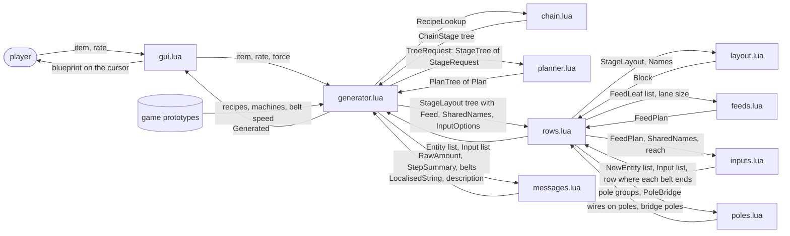
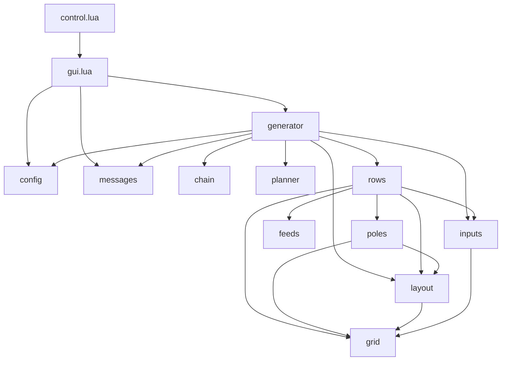
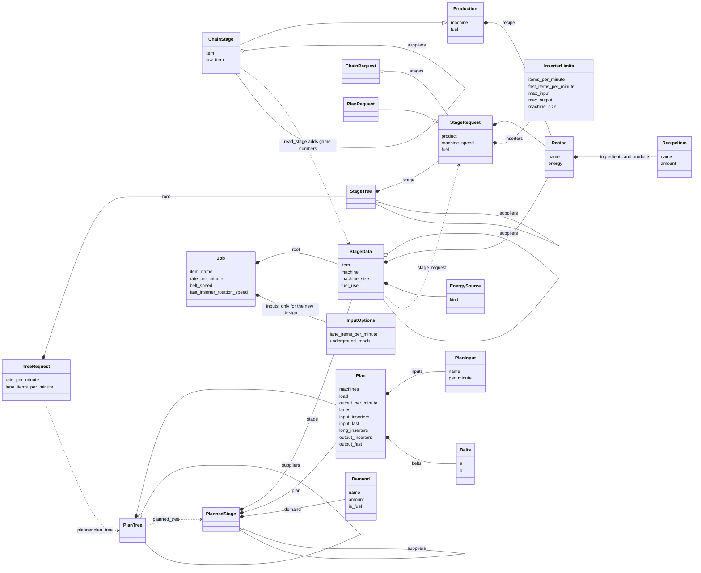
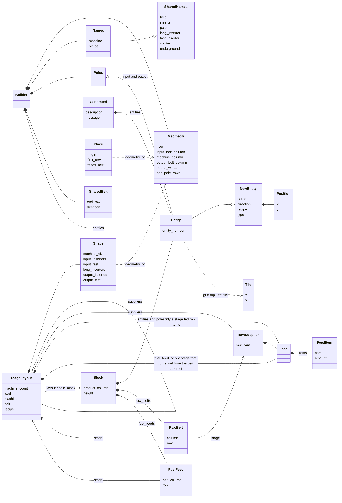
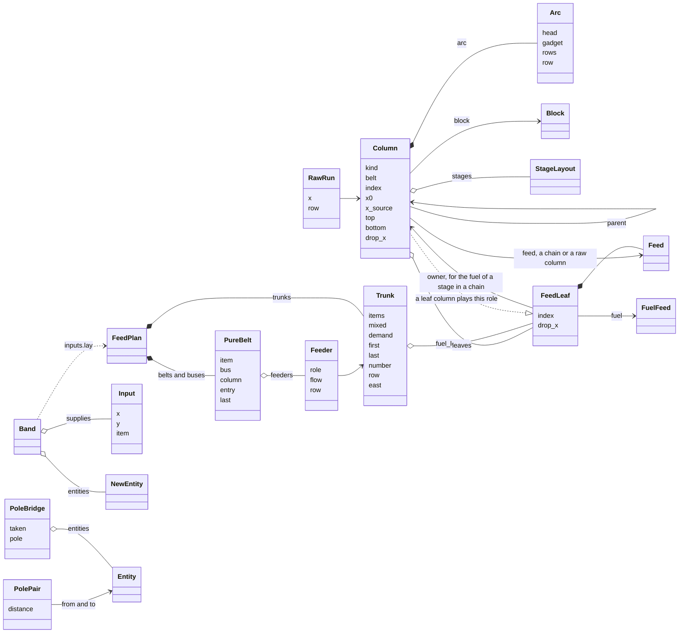

# Types and how they fit together

The mod passes a lot of small tables between modules. This file draws them so you do not have to read every `---@class`. The declarations themselves stay the source of truth: `scripts/types.lua` for types that cross modules, and the module that owns a type for the rest (the last section lists where). The diagrams leave the `bpgen.` prefix off the names.

There are four views, from the widest to the narrowest. Start with the first.

1. **Data flow**: which module hands which type to which. Answers "where does this table come from and where does it go?"
2. **Module dependencies**: who `require`s whom.
3. **Class diagrams**, one per area: what a type is made of and how types contain or extend each other.
4. **Where each type is defined.**

A single class diagram of everything would have about 70 boxes and no readable layout, which is why the class diagrams are split by area.

How to read the class diagrams: `A *-- B` means A is made of B (it holds one or a list of them); `A o-- A` means a tree (a stage holds its supplier stages); `A --|> B` means A has all the fields of B plus its own; `A ..> B` means A is read or turned into B by some function; `A --> B` is a plain reference. Only the fields that carry meaning are listed, and the types in `types.lua` have the rest.

## 1. Data flow

The generator is the only module that reads the game's prototypes; everything to its right is pure.

## 2. Module dependencies

`chain`, `planner`, `feeds`, `messages` and `config` require nothing: they work on plain tables. `types.lua` is never required; it only feeds the editor.

## 3. Class diagrams

### 3a. From the recipe to the plan (generator, chain, planner)

### 3b. What the layout is told, and what it builds (layout, rows, generator)

`Builder`, `Geometry`, `Place`, `Poles` and `SharedBelt` live inside `layout.lua`: one `Builder` lays out one column, and `rows.lua` calls it once per column.

### 3c. The columns, and the belts that come in (rows, feeds, inputs, poles)

The order of the work in `rows.build_pure` is: columns are made (`Column`), the leaves are handed to `feeds.plan` (`FeedPlan`), the columns are placed after the band, `inputs.lay` draws the band (`Band`) and says where each leaf's belt ends, the columns get their rows from that, and `poles.join` wires the poles with a `PoleBridge` for the gaps.

## 4. Where each type is defined

| Where | Types |
|---|---|
| `scripts/types.lua` (cross module) | SharedNames, Names, MachineChoice, Production, ChainStage, RecipeItem, Recipe, InserterLimits, StageRequest, ChainRequest, StageTree, TreeRequest, PlanTree, PlanRequest, PlanInput, Plan, Position, Tile, Wire, Shape, StageLayout, RawSupplier, Feed, FeedItem, BlockOptions, Block, FuelFeed, RawBelt, NewEntity, Entity, InputOptions, Input, PoleBridge, FeedLeaf, Trunk, Feeder, PureBelt, FeedPlan, Generated; the aliases ChainReason, RecipeLookup, PlanReason |
| `scripts/config.lua` | Config |
| `scripts/generator.lua` | EnergySource, Candidate, StageData, Job, PlannedStage, Demand |
| `scripts/planner.lua` | Belts, InputInserters, MachineRates, StageContext, Sizes |
| `scripts/chain.lua` | MadeIngredient |
| `scripts/layout.lua` | Geometry, Place, Poles, SharedBelt, Builder |
| `scripts/rows.lua` | Arc, Column, RawRun |
| `scripts/inputs.lua` | Band |
| `scripts/poles.lua` | PolePair |
| `scripts/messages.lua` | RawAmount, StepSummary |
